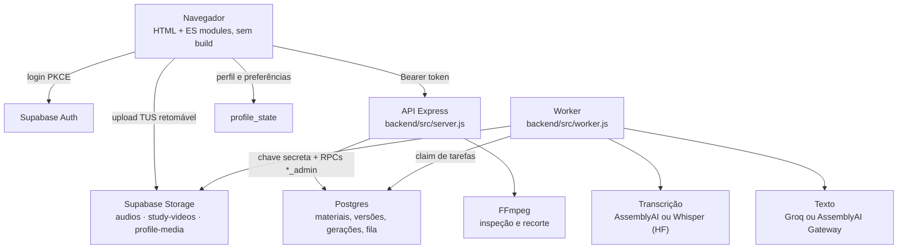

# Arquitetura

Visão técnica do Voz em Estudo. Atualizado em 20/11/2026 (a versão anterior descrevia a etapa E02;
o histórico continua no git).

## Componentes



- **Frontend** (`frontend/`): páginas HTML estáticas e módulos ES, sem framework e sem etapa de
  build. `theme-init.js` aplica preferências antes da página aparecer.
- **API** (`backend/src/app.js`): Express 5 com helmet, CORS restrito a `APP_ORIGIN`, `x-request-id`
  em toda resposta e erros padronizados. Também entrega as páginas (`SERVE_FRONTEND`).
- **Worker** (`backend/src/worker.js`): processo separado que busca tarefas na fila
  (`processing_jobs`), executa e registra eventos. Pode rodar em várias instâncias.
- **Supabase**: Auth (e-mail/senha, Google, GitHub), Postgres com RLS e Storage privado.
- **Provedores de IA** atrás de um registro (`backend/src/ai/provider-registry.js`); ver
  [AI_PROVIDERS.md](AI_PROVIDERS.md).

## Camadas do backend

| Camada              | Pasta                                    | Responsabilidade                                                                                        |
| ------------------- | ---------------------------------------- | ------------------------------------------------------------------------------------------------------- |
| Rotas e controllers | `routes/`, `controllers/`, `middleware/` | HTTP, autenticação, validação de entrada, erros                                                         |
| Validação           | `validators/`                            | Esquemas zod de cada corpo; caminhos de Storage seguros                                                 |
| Domínio             | `domain/`                                | Regras puras: plano de cobertura de questões, redundância, localização de trechos de apoio, erros       |
| Serviços            | `services/`                              | Casos de uso: mídia, processamento, geração, compartilhamento, busca                                    |
| Repositórios        | `repositories/`                          | Consultas sempre filtradas pelo dono; chamadas às RPCs `*_admin`                                        |
| Integrações         | `integrations/`                          | Supabase, AssemblyAI, Hugging Face (Gradio), Groq                                                       |
| Prompts             | `prompts/`                               | Texto versionado enviado aos modelos (`summary-v3`, `questions-v2.1`, `flashcards-v2`, `warnings-v1.0`) |
| Tarefas             | `jobs/`                                  | Execução, tentativas e atrasos                                                                          |

## Fluxo de uma aula

1. **Recorte** — o navegador manda o arquivo para `POST /api/media/inspect` (duração, forma de onda)
   e `POST /api/media/convert?output=speech`, que devolve o trecho em MP3 mono compacto.
2. **Upload** — o navegador envia o MP3 direto ao Storage pelo protocolo TUS em blocos de 6 MB, em
   `temp/{userId}/{materialId}/`, retomando do ponto confirmado se a conexão cair.
3. **Registro** — `POST /api/materials` cria aula, áudio e declaração de permissão numa transação
   (`create_material_with_permission_admin`); `POST /process` enfileira a tarefa inicial com chave
   de idempotência.
4. **Transcrição (worker)** —
   - Provedor síncrono (Whisper/HF): baixa, converte para WAV e transcreve.
   - Provedor assíncrono (AssemblyAI): máquina de estados em `ai_job_executions`
     (`pending → uploaded → submitting → processing → completed`), com transições condicionais para
     que um worker reiniciado continue em vez de reenviar. Enquanto espera, a tarefa volta para
     `AGUARDANDO_REPETICAO` sem gastar tentativas.
   - Grava a versão inicial imutável, os trechos e, se houver, os tempos por palavra.
5. **Finalização** — apaga o áudio ou move para `retained/…`, conforme a escolha; gera os três avisos
   de conteúdo (idempotentes por tarefa). A aula fica `PARCIAL` e aguardando revisão.
6. **Conferência humana** — a pessoa edita (cada edição é uma nova versão), restaura versões e
   confirma uma versão específica.
7. **Gerações** — resumos, listas e cartões só são enfileirados com a versão confirmada, que fica
   fixada na tarefa. Se a tarefa for repetida depois de gravar o resultado, o resultado existente é
   reaproveitado. A aula fica `PRONTO` quando há resumo e questões da versão atual.

Falhas temporárias (rede, 429/5xx do provedor, saída inválida do modelo, banco indisponível) são
repetidas até `JOB_MAX_ATTEMPTS` vezes; mensagens de erro são higienizadas antes de chegar ao usuário.

## Geração de questões (`questions-v2.1`)

```
transcrição confirmada
  → conceitos distintos, cada um com trecho de apoio        (chamada 1)
  → plano: conceito × habilidade × dificuldade               (sem IA; máx. 2 por conceito)
  → uma questão por vaga, com trecho de apoio                (chamada 2)
  → validação: 4 alternativas distintas, apoio localizado na transcrição,
    sem repetidas (texto, paráfrase, mesma resposta no mesmo conceito)
  → reposição das vagas vazias                               (chamada 3, opcional)
```

O trecho de apoio é localizado na transcrição de forma tolerante (o modelo costuma tirar "né", pôr
reticências ou trocar uma palavra) e gravado com as palavras reais da aula
(`domain/evidence-match.js`). A lista registra um relatório de cobertura com os motivos de descarte.

## Segurança

- **Dono primeiro**: a aula é a raiz de posse. Toda rota confere `user_id`; as RPCs `*_admin`
  recebem o usuário do token e conferem no SQL. Ver [BANCO_DE_DADOS.md](BANCO_DE_DADOS.md).
- **Navegador sem acesso de escrita** ao banco; só lê `profile_state` próprio e envia arquivos ao
  próprio prefixo do Storage.
- **Chaves**: só a chave publicável vai para o navegador; a API recusa expor uma chave secreta.
- **Caminhos de Storage** validados contra `..`, codificações e prefixos de outra conta.
- **Compartilhamento**: token aleatório de 256 bits gerado no navegador; o servidor guarda só o
  SHA-256; validade de 1/7/30 dias; revogável; respostas sem gabarito e com `noindex`.
- **Gabarito protegido** enquanto há tentativa com feedback adiado.
- **Limites**: 2 MB de JSON, 100 MB de mídia, 2 conversões simultâneas, uma geração de cartões por
  pessoa. Não há limitador de requisições global.

## Decisões registradas

- [ADR-001](decisions/ADR-001-quality-and-compatibility.md) — qualidade e compatibilidade.
- [ADR-002](decisions/ADR-002-human-review-and-generation.md) — revisão humana e fonte imutável.
- Flags desligadas por padrão; cada recurso novo chega atrás de uma flag e de uma migration aditiva.
- Provedor de IA nunca muda sozinho: reserva só se configurada, e o provedor/modelo fica fixado em
  cada tarefa.
