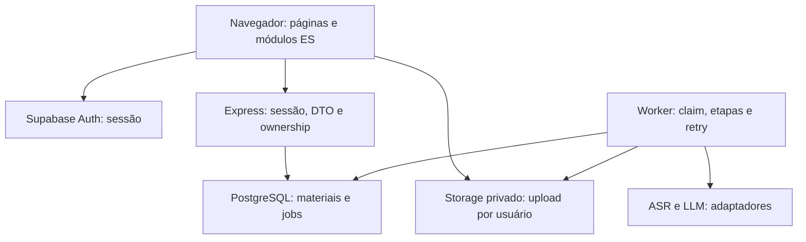

# Arquitetura vigente

O produto continua em JavaScript modular: frontend estático HTML/CSS/ES Modules, API Express e worker Node independentes, Supabase Auth/PostgreSQL/Storage e adaptadores ASR/LLM. A E01 acrescenta infraestrutura de qualidade e flags; a E02 acrescenta declaração, conferência humana, avisos e fonte imutável de geração. Catálogo, planejamento, tracking e quiz v2 continuam fora desta etapa.

## Responsabilidades reais

| Camada            | Arquivos                                    | Responsabilidade                                                      |
| ----------------- | ------------------------------------------- | --------------------------------------------------------------------- |
| Inicialização API | backend/src/app.js, server.js               | Middleware, routers, configuração pública e arquivos frontend         |
| HTTP              | backend/src/routes, controllers, middleware | Sessão, entrada/saída e erros com requestId                           |
| Regras            | backend/src/services, domain, validators    | Mídia/recortes, derivação, validação e autorização antes de persistir |
| Persistência      | backend/src/repositories                    | Consultas filtradas por owner; SDK administrativo somente no servidor |
| Worker            | backend/src/worker.js, jobs/job-runner.js   | Fila persistente, etapas, tentativas e eventos                        |
| Integrações       | backend/src/integrations                    | Supabase, Groq, Gradio/Hugging Face                                   |
| UI                | frontend/js/pages, api, utils               | Jornadas, HTTP, player, preferências e estudo local                   |
| ASR opcional      | asr-space/app.py                            | Interface Gradio e adaptação de chunks para milissegundos             |

Controllers legados de transcrição/questões ainda chamam alguns repositories diretamente para verificação de ownership/leitura. É um desvio documentado da separação ideal, não motivo para criar novas camadas ou reestruturar todos os controllers na E01.

## Fluxos preservados

Auth usa e-mail/senha e OAuth Google/GitHub com PKCE. A API verifica o token com Supabase antes das rotas protegidas. O browser recebe apenas configuração pública; nenhuma chave administrativa é necessária em CI.

A inspeção/conversão autenticada aceita nove formatos. O recorte vira WAV mono 16 kHz para upload em temp/{userId}/{materialId}/arquivo. A API registra material/áudio e declaração versionada na mesma transação. O job inicial transcreve, persiste a revisão, resolve retenção e registra avisos; não gera resumo/questões. A confirmação humana libera jobs de geração que leem o snapshot fixado no enqueue. Retenção atual é do WAV do trecho, não do MP4 original. Download de exportação MP4 continua disponível.

Materiais são a raiz de ownership. Jobs são filtrados pelo owner do material; questões passam pelo lote/material. Guardas da E00 rejeitam chaves Storage que poderiam mudar com normalização de URL. URLs assinadas têm TTL de 600 segundos no contrato legado.

Título/disciplina e conteúdo vêm da API; perfil/avatar vêm de Auth user_metadata. Tags extras, temas nomeados, progresso de reprodução, acessos, revisão explícita e respostas locais continuam por usuário neste navegador. Eles não medem atenção ou minutos estudados e não são sincronizados entre aparelhos.

## Contratos e evolução

[OpenAPI](engineering/AudioEstudo_openapi.yaml) descreve rotas efetivas, inclusive config/media, UUID de criação obrigatório, DTO de job snake_case e erros. E01 corrige JSON malformado para 400 INVALID_JSON com requestId, bloqueia chaves privadas em /api/config e acrescenta featureFlags em /api/config. Flags não são usadas para autorização e não habilitam capacidades ainda ausentes.

Cada entrega futura deve validar schema/RLS/ownership, DTO, serviço, UI, regressão e documentação quando aplicável. Não reescrever 001_initial.sql nem inventar histórico de migrations. O catálogo remoto existe apesar de o histórico registrado estar vazio; ver [baseline E00](implementation-2.0/00-baseline.md).

## Limites e decisões

A E02 usa RPCs transacionais com lock por material, revisão imutável/confirmada no enqueue e conclusão idempotente por job. Derivados/avisos anteriores são preservados. RLS/ownership/rollback foram testados localmente em PostgreSQL embutido; concorrência em múltiplas conexões, grants/Storage reais e rollout permanecem pendentes. MOCK_EXTERNAL_SERVICES simula ASR/LLM, não substitui Supabase. CI substitui o transporte HTTP de Supabase por fixtures, sem dados pessoais. Modelo/GPU, provedores reais e restore não foram inferidos a partir dos mocks.

Ver [ADR-001](decisions/ADR-001-quality-and-compatibility.md), [padrões](CODING_STANDARDS.md) e [contrato de testes](implementation-2.0/testing-contract.md).

## Fluxo acadêmico E02

`materials.review_state` separa `pending_transcription`, `awaiting_review` e `ready_to_generate` dos enums legados de material/job. Confirmação usa UUID de revisão, conta, versão da declaração e UTC. Snapshot histórico e fonte de job ficam imutáveis. Edição/restauração exige outra confirmação, sem alterar a fonte de jobs anteriores.

`material_permissions`, `transcription_confirmations` e `content_warnings` são estruturas aditivas com RLS. RPCs server-only verificam ownership mesmo com cliente administrativo. O banco serializa número de versão/current e grava lote/questões num commit. Provedor roda fora dos locks; retry após commit reutiliza o derivado existente. Storage não compartilha transação; há reconciliação de move finalizado antes de falha do banco.

Avisos são três análises independentes com JSON validado, referência ao snapshot e histórico de execuções; erro/insuficiência não certifica conteúdo. A UI diferencia progresso pessoal local de confirmação científica no servidor. Ver [ADR-002](decisions/ADR-002-human-review-and-generation.md), [runbook](implementation-2.0/02-review-migration-runbook.md) e [manual de uso](user-manual.md). G1 não foi aprovado e não houve migration remota.
