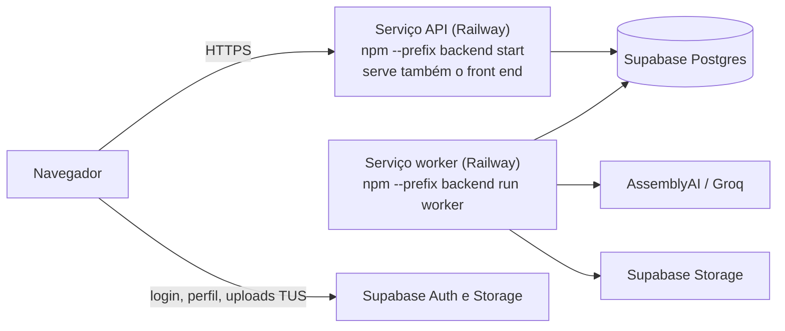

# Hospedagem pública (preparação)

Guia para publicar o Voz em Estudo como protótipo. **Nada foi publicado**: este documento e os
arquivos em `deploy/` preparam a publicação, que depende das etapas manuais no fim.

## Arquitetura recomendada

- **Um serviço de API** (Node 22) que também entrega as páginas (`SERVE_FRONTEND=true`, padrão).
  Precisa rodar a partir da **raiz do repositório**: ele serve `frontend/` a partir de
  `backend/src/../../frontend`. Uma instância basta para o protótipo e mantém os limites por conta
  exatos (ver Segurança).
- **Um serviço de worker** com o mesmo código, sem porta HTTP. Busca tarefas na fila do banco e
  chama os provedores de IA. Pode ter mais de uma instância (reservas com renovação evitam
  execução dupla), mas uma basta.
- **Supabase** existente (Postgres, Auth, Storage). O teste público usa as migrações de 25/11 (já aplicadas; ver [LANCAMENTO_TESTE_PUBLICO.md](LANCAMENTO_TESTE_PUBLICO.md)). Nenhuma outra é necessária para esta
  versão.
- FFmpeg/ffprobe vêm dos pacotes npm (`ffmpeg-static`, `ffprobe-static`); não é preciso instalar
  nada no sistema.

## Serviços e comandos

| Serviço | Build                                                     | Início                            | Verificação                         |
| ------- | --------------------------------------------------------- | --------------------------------- | ----------------------------------- |
| API     | `npm ci --prefix backend --omit=dev --no-audit --no-fund` | `npm --prefix backend start`      | `GET /api/health` → `{"ok":true}`   |
| Worker  | o mesmo                                                   | `npm --prefix backend run worker` | log `WORKER_STARTED`; tarefas andam |

Exemplos de configuração do Railway (config como código, um arquivo por serviço):
`deploy/railway.api.json` e `deploy/railway.worker.json`. No Railway, crie dois serviços a partir do
mesmo repositório, **diretório raiz = raiz do repositório**, e aponte cada um para o seu arquivo.
Node: o `package.json` da raiz exige `>=22.19.0`; defina a versão 22 no serviço se a plataforma não
detectar sozinha.

Testado neste contêiner (sem publicar): com variáveis de exemplo, a API inicia a partir da raiz,
`/api/health` responde 200, `painel.html` e os catálogos de idioma são servidos, rotas inexistentes
dão 404 e o processo termina em menos de 2 s com `SIGTERM` (há um limite de 10 s para conexões
ociosas). O worker termina a tarefa atual ao receber `SIGTERM`; uma tarefa interrompida é retomada
por outra execução quando a reserva vence (`WORKER_STALE_LEASE_SECONDS`).

## Variáveis de ambiente (sem valores secretos aqui)

Use `backend/.env.example` como referência completa. Mínimo para produção:

| Variável                              | API | Worker | Observação                                                     |
| ------------------------------------- | --- | ------ | -------------------------------------------------------------- |
| `NODE_ENV=production`                 | ✓   | ✓      |                                                                |
| `PORT`                                | ✓   |        | O Railway define sozinho                                       |
| `APP_ORIGIN`                          | ✓   |        | `https://seu-dominio` exato (CORS)                             |
| `SERVE_FRONTEND=true`                 | ✓   |        | Padrão                                                         |
| `SUPABASE_URL`                        | ✓   | ✓      |                                                                |
| `SUPABASE_PUBLISHABLE_KEY`            | ✓   | ✓      | Chave publicável (vai para o navegador)                        |
| `SUPABASE_SECRET_KEY`                 | ✓   | ✓      | **Secreta**, só no servidor                                    |
| `SUPABASE_AUDIO_BUCKET`               | ✓   | ✓      | `audios`, se não mudou                                         |
| `OAUTH_PROVIDERS`                     | ✓   |        | `google,github` ou vazio                                       |
| `ASR_PROVIDER`, `ASR_MODEL`, …        |     | ✓      | Ver [AI_PROVIDERS.md](AI_PROVIDERS.md)                         |
| `ASSEMBLYAI_API_KEY` / `GROQ_API_KEY` |     | ✓      | **Secretas**; a API também precisa se gerar prévias de cartões |
| `LLM_PROVIDER`, `LLM_MODEL`, …        | ✓   | ✓      |                                                                |
| `WORKER_ID`, `WORKER_CONCURRENCY=1`   |     | ✓      | Um ID por instância                                            |
| `JOB_MAX_ATTEMPTS=3`                  |     | ✓      | Orçamento de novas tentativas                                  |
| `FEATURE_*`                           | ✓   | ✓      | Os mesmos valores nos dois serviços                            |
| `RATE_LIMIT_*`                        | ✓   |        | Limites por conta (ver abaixo)                                 |
| `CONTENT_SECURITY_POLICY`             | ✓   |        | Vazio: `enforce` em produção; `off`, `report-only`, `enforce`  |
| `TRUST_PROXY`                         | ✓   |        | Saltos de proxy confiáveis (limite dos links públicos)         |
| `MOCK_EXTERNAL_SERVICES`              |     |        | **Não** definir em produção                                    |

## Domínio, HTTPS e Supabase Auth

1. Domínio próprio ou o domínio `*.up.railway.app` do serviço da API (HTTPS automático).
2. `APP_ORIGIN` igual ao endereço público, sem barra no fim.
3. Supabase › Authentication › URL Configuration:
   - **Site URL**: `https://seu-dominio`
   - **Redirect URLs**: `https://seu-dominio/auth-callback.html` e
     `https://seu-dominio/recuperar-senha.html` (o app monta esses endereços a partir da página
     atual).
4. Google/GitHub (se usados): o callback do provedor continua sendo o do Supabase; só a lista de
   redirecionamentos do Supabase muda.
5. Storage: os buckets `audios`, `study-videos` e `profile-media` já existem com políticas por dono.

## Como verificar depois de publicar

1. `https://seu-dominio/api/health` → `{"ok":true,...}`.
2. `https://seu-dominio/api/config` → só chaves públicas e as flags esperadas (nunca a chave secreta).
3. Abrir `/login.html`, criar conta de teste, entrar.
4. Enviar uma gravação **curta** (custo do provedor): a tarefa sai de "na fila", o worker registra o
   progresso e a aula abre para conferência.
5. Sair da conta e conferir que a tela de entrada não mostra o tema nem o idioma da conta.

## Como tirar do ar ou fechar o acesso

- **Pausar**: parar o serviço da API (as páginas saem do ar) e o worker (para gastos com IA).
- **Fechar cadastro**: Supabase › Authentication › desativar novos cadastros (sign-ups).
- **Desligar recursos**: `FEATURE_*=false` e reiniciar os dois serviços.
- **Cortar custos de IA**: remover `ASSEMBLYAI_API_KEY`/`GROQ_API_KEY` do worker; tarefas falham
  sem cobrança.

## Segurança

- Chaves secretas só no servidor; `/api/config` recusa expor chave secreta (teste automático).
- CORS restrito a `APP_ORIGIN`; JSON limitado a 2 MB; mídia a 100 MB; duas conversões de mídia ao
  mesmo tempo.
- **Limites por conta** (novos): início de transcrição (`RATE_LIMIT_TRANSCRIPTIONS_PER_DAY`, 20/dia),
  gerações de resumo, questões e prévia de cartões (`RATE_LIMIT_GENERATIONS_PER_HOUR`, 30/h) e
  conversão de mídia (`RATE_LIMIT_MEDIA_PER_MINUTE`, 20/min). Respondem 429 com `Retry-After`.
  **Limitação honesta**: a contagem fica na memória de cada processo da API. Com uma instância é um
  teto real; com várias, cada uma conta à parte; reiniciar zera a contagem. Um limite global
  exigiria Redis ou uma tabela no banco (não feito: pediria migration e aprovação).
- **CSP** aplicada (`enforce`) por padrão quando `NODE_ENV=production`; `report-only` ou `off`
  continuam disponíveis por `CONTENT_SECURITY_POLICY`. `frontend/tests/csp-enforce-check.cjs`
  abre as 33 páginas sem sessão com a política aplicada (sem violações). Ver
  `docs/SECURITY_AUDIT_PUBLIC_TESTING.md`.
- Dados por dono: todas as rotas filtram por usuário; RLS no Supabase. Links públicos usam token de
  256 bits, guardam só o hash e expiram.
- Erros devolvem mensagem higienizada e `x-request-id`; detalhes ficam no log do servidor.

## Custos e recursos (padrões conservadores para o TCC)

- `WORKER_CONCURRENCY=1`, `JOB_MAX_ATTEMPTS=3`, `ASR_MAX_WAIT_MS` padrão (3 h).
- A transcrição AssemblyAI não é reenviada em novas tentativas (máquina de estados). Uma resposta
  inválida do modelo de texto **repete** a geração (custo repetido, até 3×).
- Limites por conta acima; ajuste para baixo num teste aberto.
- Arquivos temporários de mídia ficam no disco do contêiner só durante a conversão. Uploads
  abandonados em `audios/temp/` não são apagados automaticamente (dívida no ROADMAP).
- Uma instância pequena de API e uma de worker bastam; o Supabase gratuito tem limites de banco e
  de Storage que devem ser acompanhados.

## O que você precisa fazer (manual)

1. Criar os dois serviços no Railway (ou equivalente) com os arquivos de `deploy/`.
2. Cadastrar as variáveis (secretas só no painel da plataforma).
3. Configurar Site URL e Redirect URLs no Supabase.
4. Decidir as flags `FEATURE_*` para o público.
5. Ligar a CSP em `report-only`, testar, depois `enforce`.
6. Seguir "Como verificar" com uma conta de teste e uma gravação curta.
7. (Opcional, pede aprovação) aplicar a migration de desempenho de RLS antes de abrir para muita
   gente.
